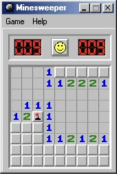

# Minesweeper

[한국어](README.ko.md)

A Windows 2000 Minesweeper recreation for macOS, built with Electron.



## Features

- Original pixel artwork, icons, bitmap-style fonts, menus, and counters.
- Beginner, Intermediate, Expert, and custom boards; flags, question marks, and chording.
- Classic rules: only the first uncovered square is guaranteed safe. A surrounding 3×3 safe area is not guaranteed.
- Local best times and preferences, with optional synthesized sound effects.
- A draggable Windows-style title bar, separate movable dialogs, and Dock progress.
- Resizing and zoom from 75% to 400%, limited to the available display area.
- An offline browser version from the same game source.

## Run from source

Use Node.js 24 or later and pnpm 11.25.0 on macOS 13 or later.

```sh
pnpm install --frozen-lockfile
pnpm test
pnpm start
```

The first launch downloads the Electron runtime. The game runs offline afterward.

For the browser version, run `pnpm dev:web` and open <http://localhost:8765>.

## Build

```sh
pnpm package:mac
pnpm build:offline
```

The macOS command builds for the current Mac's architecture. On Apple Silicon, it creates `release/Minesweeper-darwin-arm64/Minesweeper.app` and `release/Minesweeper-macOS-arm64.zip`. Use `pnpm package:mac --arch=x64` for an Intel build or `pnpm package:mac --arch=arm64` for Apple Silicon. Intel builds have not been tested on hardware.

Packaging applies and verifies a local ad-hoc signature. The build is not notarized or signed with an Apple Developer ID.

The offline command creates `release/Minesweeper.html`, which can be opened directly in a browser.

## Controls

| Action | Control |
| --- | --- |
| Uncover a square | Left click |
| Flag → question mark → clear | Right click |
| Uncover neighbors when the flag count matches | Both mouse buttons or middle click |
| New game | Face button or F2 |
| Keyboard play | Arrow keys, Space / Enter, F to flag, Shift+Space to chord |
| Zoom | Resize the window, View menu, or Command+Plus / Minus / 0 |
| Sound | Game → Sound |

Touch controls are also available: tap to uncover, hold to flag, and tap an uncovered number to chord. Question marks can be disabled in Game → Marks (?).

## Project layout

```text
src/          Browser game and assets
electron/     macOS window integration
scripts/      Development and packaging commands
tests/        Game and desktop tests
resources/    macOS app icon
docs/         Screenshots
```

## License and credits

Program code and synthesized sound effects: **MIT License, © 2026 Kyumin Nam**. See [LICENSE](LICENSE).

Original Microsoft artwork and other third-party resources retain their respective rights and licenses; they are not relicensed under this project's MIT license. See [THIRD_PARTY_NOTICES.md](THIRD_PARTY_NOTICES.md) for sources and notices.

This is an independent recreation and is not affiliated with Microsoft.
