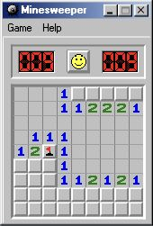

# Minesweeper

The Windows 2000 Minesweeper recreation for Windows, macOS, and Linux, built with Electron.



## Features

- Original pixel artwork, icons, bitmap-style fonts, menus, and counters.
- Beginner, Intermediate, Expert, and custom boards; flags, question marks, and chording.
- Classic rules: only the first uncovered square is guaranteed safe. A surrounding 3×3 safe area is not guaranteed.
- Local best times and preferences, with optional synthesized sound effects.
- A draggable Windows-style title bar, floating menus, and separate movable dialogs.
- Taskbar or Dock progress where supported by the desktop.
- Resizing and zoom from 75% to 400%, limited to the available display area.
- An offline browser version from the same game source.

## Downloads

Get a build from [Releases](https://github.com/miniprime1/minesweeper/releases).

| Platform | Archive | Run |
| --- | --- | --- |
| macOS, Apple Silicon | `Minesweeper-macOS-arm64.tar.gz` | Extract and move `Minesweeper.app` to Applications. |
| macOS, Intel | `Minesweeper-macOS-x64.tar.gz` | Extract and move `Minesweeper.app` to Applications. |
| Windows, x64 | `Minesweeper-Windows-x64.zip` | Extract the entire folder and run `Minesweeper.exe`. |
| Linux, x64 | `Minesweeper-Linux-x64.tar.gz` | Extract the entire folder and run `./Minesweeper`. |

Requires Windows 10 or later, macOS 13 or later, or a Linux desktop with X11/XWayland. The macOS builds have a local ad-hoc signature and are not notarized. Windows builds are not code-signed.

## Run from source

Use Node.js 24 or later and pnpm 11.25.0.

```sh
pnpm install --frozen-lockfile
pnpm test
pnpm start
```

The first launch downloads the Electron runtime. The game runs offline afterward.

For the browser version, run `pnpm dev:web` and open <http://localhost:8765>.

## Build

```sh
pnpm package
pnpm build:offline
```

`pnpm package` builds for the current operating system and CPU architecture. Output goes to `release/`. Specify a target when needed:

```sh
pnpm package:mac --arch=arm64
pnpm package:mac --arch=x64
pnpm package:windows --arch=x64
pnpm package:linux --arch=x64
```

macOS archives contain only `Minesweeper.app`; licenses and resource credits are inside the app. Windows and Linux archives include the complete portable app folder and runtime files. macOS packaging requires a Mac for signing. The generic `--platform` option accepts `darwin`, `win32`, or `linux`; `--arch` accepts `x64` or `arm64`.

The **Package desktop apps** GitHub Actions workflow builds all four targets on their respective operating systems and uploads downloadable artifacts. It does not publish a release. CI runs the game and desktop tests on Windows, macOS, and Linux. Packaging checks do not replace testing on each target machine.

The offline command creates `release/Minesweeper.html`, which can be opened directly in a browser.

## Controls

| Action | Control |
| --- | --- |
| Uncover a square | Left click |
| Flag → question mark → clear | Right click |
| Uncover neighbors when the flag count matches | Both mouse buttons or middle click |
| New game | Face button or F2 |
| Keyboard play | Arrow keys, Space / Enter, F to flag, Shift+Space to chord |
| Zoom | Resize the window, or Ctrl+Plus / Minus / 0 (Command on macOS) |
| Sound | Game → Sound |

Touch controls are also available: tap to uncover, hold to flag, and tap an uncovered number to chord. Question marks can be disabled in Game → Marks (?).

## Project layout

```text
src/          Browser game and assets
electron/     Desktop windows, menus, dialogs, and progress
scripts/      Development and packaging commands
tests/        Game and desktop tests
resources/    Platform packaging assets
docs/         Screenshots
```

## License and credits

Program code and synthesized sound effects: **MIT License, © 2026 Kyumin Nam**. See [LICENSE](LICENSE).

Original Microsoft artwork and other third-party resources retain their respective rights and licenses; they are not relicensed under this project's MIT license. See [THIRD_PARTY_NOTICES.md](THIRD_PARTY_NOTICES.md) for sources and notices.

This is an independent recreation and is not affiliated with Microsoft.
